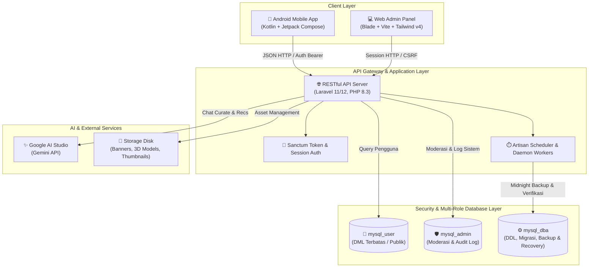

<div align="center">

# 🏛️ VEN — Value Exhibition Network
### *The Next-Generation Digital Art & 3D Value Gallery Ecosystem*

[](ven-mobile/)
[](backend-api/backend/)
[](backend-api/backend/)
[](backend-api/backend/)
[](ven-mobile/docs/DESIGN.md)
[](backend-api/backend/docs/)

<p align="center">
  <b>VEN (Value Exhibition Network)</b> adalah ekosistem pameran seni dan galeri 3D digital interaktif yang menjembatani seniman, desainer, kurator, dan pengunjung dalam ruang pameran imersif. Memadukan aplikasi native <b>Android (Jetpack Compose)</b> dengan backend RESTful API berkinerja tinggi berbasis <b>Laravel 11/12</b>, arsitektur basis data <i>Least Privilege</i>, audit keamanan berlapis, serta integrasi kecerdasan buatan <b>Google Gemini</b>.
</p>

---

</div>

## 📑 Daftar Isi
- [🏛️ VEN — Value Exhibition Network](#️-ven--value-exhibition-network)
    - [*The Next-Generation Digital Art \& 3D Value Gallery Ecosystem*](#the-next-generation-digital-art--3d-value-gallery-ecosystem)
  - [📑 Daftar Isi](#-daftar-isi)
  - [💡 Tentang VEN](#-tentang-ven)
  - [🏛️ Arsitektur Sistem](#️-arsitektur-sistem)
  - [✨ Fitur Utama](#-fitur-utama)
    - [1. Mobile Client (Android Native)](#1-mobile-client-android-native)
    - [2. Backend API \& Admin Web Panel](#2-backend-api--admin-web-panel)
    - [3. 7 Pilar Kepatuhan Audit Keamanan Basis Data](#3-7-pilar-kepatuhan-audit-keamanan-basis-data)
  - [📁 Struktur Repositori](#-struktur-repositori)
  - [🚀 Panduan Memulai Cepat (Getting Started)](#-panduan-memulai-cepat-getting-started)
    - [Prasyarat Sistem](#prasyarat-sistem)
    - [Langkah Setup Backend \& Database](#langkah-setup-backend--database)
    - [Langkah Menjalankan Mobile App](#langkah-menjalankan-mobile-app)
  - [🧪 Pengujian Otomatis (Automated Testing)](#-pengujian-otomatis-automated-testing)
    - [1. Backend API \& Keamanan Database (PHPUnit)](#1-backend-api--keamanan-database-phpunit)
    - [2. Android Mobile Client (Gradle Unit Test)](#2-android-mobile-client-gradle-unit-test)
    - [3. Postman API Suite](#3-postman-api-suite)
  - [🛠️ Standar Pengembangan \& Git Workflow](#️-standar-pengembangan--git-workflow)
  - [📄 Lisensi \& Hak Cipta](#-lisensi--hak-cipta)

---

## 💡 Tentang VEN

Platform **VEN** dirancang untuk mendemokratisasi akses karya seni, desain grafis, poster, dan model 3D melalui ruang Value digital. Melalui platform ini:
1. **Kreator** dapat mempublikasikan karya poster 2D maupun merancang ruang pameran 3D (*Value Exhibit*) lengkap dengan penataan furnitur dan pencahayaan.
2. **Pengunjung** dapat menjelajahi galeri pameran secara Value, melihat detail karya, mengajukan jadwal pertemuan (*Request Meeting*), dan berkonsultasi dengan asisten kurator AI cerdas.
3. **Administrator & Kurator** memiliki dasbor terpusat untuk memoderasi karya, memverifikasi kepatuhan konten pameran, mengaudit log aktivitas sistem, dan mengelola sanksi akun secara *real-time*.

---

## 🏛️ Arsitektur Sistem

Ekosistem VEN dibangun dengan memisahkan domain aplikasi secara bersih:



---

## ✨ Fitur Utama

### 1. Mobile Client (Android Native)
Dibangun menggunakan **Kotlin** dan **Jetpack Compose** dengan pendekatan *Unidirectional Data Flow (UDF)* dan desain berbasis *Material 3*:

* 🚀 **Smart Feed & Refresh System (Instagram Style)**:
  * **Pull-to-Refresh**: Usap layar ke bawah dari bagian atas untuk memicu pembaruan data secara dinamis dengan animasi spinner Material 3.
  * **Double-Tap Tab Bar**: Ketuk tab *Beranda* atau *Explore* dua kali untuk scroll instan ke paling atas dan menyaring karya yang sudah pernah dilihat (`seenMediaIds`), memastikan selalu tersaji hal-hal baru dan segar.
  * **State Hoisting**: Posisi scroll daftar karya tersimpan aman antar perpindahan tab navigasi.
* 🖼️ **Feed Beranda Imersif**:
  * Carousel pameran *Coming Soon* dengan banner visual tajam.
  * Kartu karya (*PostCard*) elegan dengan rasio media dinamis, tombol navigasi jadwal langsung, dan pemanggil 3D exhibit viewer.
* 🔍 **Explore & Unified Discovery**:
  * Grid eksplorasi 3 kolom dengan *Memory LRU Cache* (0ms) dan *Disk Cache* ter-downsample (360x480).
  * Pencarian terpadu dengan *debounce* instan: tab *For You, Accounts, Posts,* dan *Exhibits*.
  * Filter modal kategori dinamis berbasis *Bottom Sheet*.
* 🏛️ **3D Exhibition Editor**:
  * Pembuatan ruang pameran Value interaktif: checklist persiapan, penamaan, pemilihan template ruang, penempatan objek/furnitur, dan kontrol palet warna.
* 📅 **Jadwal Pertemuan (Schedule & Meeting Requests)**:
  * Pengajuan, peninjauan, dan konfirmasi jadwal temu kurator/seniman (*Approved, Waiting, Requests*).
* 🤖 **Asisten Cerdas AI (Gemini Assistant)**:
  * Panel drawer interaktif untuk tanya jawab seputar karya seni dan kurasi pameran.
* 🌗 **Theme Engine (Dark & Light Mode)**:
  * Dioptimalkan khusus untuk **Dark Mode** elegan yang menonjolkan estetika warna karya seni pengguna.

---

### 2. Backend API & Admin Web Panel
Dibangun di atas fondasi **Laravel 11/12** dengan performa tinggi dan struktur modular:

* **High-Performance RESTful API**: Endpoint JSON terstruktur rapi untuk seluruh alur bisnis aplikasi mobile.
* **Web Admin Panel Terintegrasi**: Dasbor moderasi karya, verifikasi pameran, manajemen pengguna, inspeksi riwayat aktivitas (*LogAudit*), dan penjatuhan sanksi akun berbasis **Blade Views** dan **Tailwind CSS v4**.
* **Proteksi Mutasi Data**: Validasi ketat Form Request, *Policy-based authorization*, dan pencegahan injeksi payload.
* **Integrasi AI Gemini**: Endpoint analitik kurasi dan rekomendasi konten otomatis.

---

### 3. 7 Pilar Kepatuhan Audit Keamanan Basis Data

Backend VEN telah diaudit secara formal dan memenuhi 7 standar ketat arsitektur basis data:

| No | Standar Audit | Implementasi Teknis pada VEN |
|:--:|---|---|
| **1** | **Pembatasan Akses dengan View** | Filter data sensitif (`kata_sandi`, `google_id`, `role`) menggunakan view basis data `v_pengguna_publik` untuk konsumsi endpoint publik. |
| **2** | **Hashing & Salting** | Proteksi seluruh kata sandi menggunakan algoritma **Bcrypt** (`$2y$`) dengan *salt* unik dinamis. |
| **3** | **Enkripsi AES-256-GCM & Blind Index** | Enkripsi simetris data sensitif pihak ketiga (`google_id`) via AES-256-GCM dengan *Blind Index* (HMAC-SHA-256) untuk pencarian terenkripsi berkecepatan tinggi. |
| **4** | **Database Transactions (ACID)** | Eksekusi transaksi atomik (`DB::transaction`) yang menjamin sifat *Commit* pada alur sukses dan *Rollback* menyeluruh saat terjadi kendala. |
| **5** | **Concurrent Access & Locking** | Proteksi *race condition* saat moderasi sanksi akun dan klaim pameran dengan *Pessimistic Row Locking* (`lockForUpdate`). |
| **6** | **Backup Otomatis & Terjadwal** | Pencadangan basis data berkala setiap tengah malam (00:00) dengan retensi rotasi 30 hari serta perintah manual DBA `ven:backup-db`. |
| **7** | **Disaster Recovery Sandbox Verification** | Otomasi verifikasi pemulihan cadangan database ke sandbox terisolasi via perintah `ven:restore-db`. |

> 📖 *Dokumentasi teknis lengkap masing-masing kepatuhan dapat ditinjau di direktori [`backend-api/backend/docs/`](backend-api/backend/docs/).*

---

## 📁 Struktur Repositori

```text
ven/
├── .agents/                   # Panduan AI rules, best practices, dan workflow skills
│   ├── rules/                 # Aturan koding bersih, arsitektur, dan kebijakan git
│   └── skills/                # Standar spesialisasi Laravel, Android Compose, dan TDD
├── backend-api/
│   └── backend/               # Core Laravel Backend & Admin Web Panel
│       ├── app/
│       │   ├── Http/Controllers/ # Controller API dan Controller Web Admin
│       │   ├── Models/           # Eloquent Models (Karya, Pameran, Pengguna, Objek, dsb.)
│       │   ├── Services/         # Layer Logika Bisnis & Layanan Gemini AI
│       │   └── Observers/        # Observer Aktivitas & Audit Database
│       ├── config/               # Konfigurasi database multi-role, backup, & AI
│       ├── database/             # Migrasi skema database, Seeder data, & Views
│       ├── docs/                 # Dokumentasi formal 7 pilar audit keamanan database
│       ├── resources/views/      # Template Blade untuk Admin Web Panel (Tailwind CSS v4)
│       └── tests/                # Automated PHPUnit Test Suites
├── ven-mobile/                # Aplikasi Klien Android Native
│   ├── app/src/main/
│   │   ├── java/com/ven/app/
│   │   │   ├── data/             # API Service, Retrofit Client, & Data Models
│   │   │   ├── ui/
│   │   │   │   ├── components/   # Komponen UI bersama (VexChip, PostCard, MediaGrid)
│   │   │   │   ├── navigation/   # Routing AppNavigation & BottomNav Bar
│   │   │   │   ├── screens/      # Feature Screens (Home, Explore, Schedule, AI, Create)
│   │   │   │   └── theme/        # Token desain resmi VEN (Color, Space, Typography)
│   │   │   └── util/             # Utility format tanggal, cache, & helper
│   │   └── res/                  # Vector drawables, strings lokalisasi, & resource visual
│   └── docs/DESIGN.md            # Spesifikasi desain visual & alur interaksi Figma
└── postman/                   # Koleksi pengujian endpoint API & suite verifikasi audit
```

---

## 🚀 Panduan Memulai Cepat (Getting Started)

### Prasyarat Sistem
* **Backend**: PHP >= 8.3, Composer >= 2.6, MySQL >= 8.0/8.4 (Laragon sangat disarankan di Windows).
* **Mobile**: Android Studio (Ladybug / Meerkat / terbaru), JDK 17, Android SDK Platform 34/35.

---

### Langkah Setup Backend & Database

1. **Masuk ke folder backend**:
   ```bash
   cd backend-api/backend
   ```

2. **Pasang dependensi PHP & Node.js**:
   ```bash
   composer install
   npm install
   ```

3. **Konfigurasi Environment**:
   ```bash
   cp .env.example .env
   php artisan key:generate
   ```
   *Pastikan kredensial database pada `.env` telah disesuaikan dengan konfigurasi MySQL lokal Anda.*

4. **Inisialisasi Database Multi-Role (Least Privilege)**:
   ```bash
   php artisan ven:setup-db
   ```

5. **Jalankan Migrasi Skema & Seeder**:
   ```bash
   php artisan migrate --database=mysql_dba
   php artisan db:seed
   ```

6. **Jalankan Development Server**:
   ```bash
   # Menjalankan server API dan kompilasi asset frontend secara simultan
   npm run dev
   # Di terminal terpisah:
   php artisan serve
   ```
   *RESTful API server akan aktif di `http://127.0.0.1:8000` dan Admin Web Panel dapat diakses di `http://127.0.0.1:8000/admin`.*

---

### Langkah Menjalankan Mobile App

1. Buka folder [`ven-mobile/`](ven-mobile/) di **Android Studio**.
2. Biarkan Gradle melakukan sinkronisasi dependensi proyek (*Gradle Sync*).
3. Pastikan backend API berjalan. Jika menggunakan Emulator Android standar, backend dapat diakses melalui host bawaan `10.0.2.2:8000`.
4. Pilih target perangkat (Emulator atau Perangkat Fisik via USB Debugging).
5. Klik **Run 'app'** (`Shift + F10`) atau jalankan perintah kompilasi:
   ```powershell
   cd ven-mobile
   .\gradlew.bat installDebug
   ```

---

## 🧪 Pengujian Otomatis (Automated Testing)

Integritas sistem VEN diuji secara berkala untuk memastikan reliabilitas tinggi:

### 1. Backend API & Keamanan Database (PHPUnit)
```powershell
cd backend-api/backend
php artisan test
```
> ✅ **Status: 37 tests passed, 176 assertions (100% Lulus, 0 Error).**

### 2. Android Mobile Client (Gradle Unit Test)
```powershell
cd ven-mobile
.\gradlew.bat testDebugUnitTest
```
> ✅ **Status: Seluruh unit test Jetpack Compose & ViewModel sukses.**

### 3. Postman API Suite
Koleksi lengkap pengujian endpoint API dan verifikasi 7 pilar kepatuhan database tersedia di folder [`postman/`](postman/) siap diimpor ke Postman.

---

## 🛠️ Standar Pengembangan & Git Workflow

1. **Clean Code & Architecture**: Seluruh kontribusi wajib mengikuti kaidah *Skinny Controller, Business Logic in Services, Unidirectional Data Flow (Compose)*, dan dokumentasi fungsi yang rapi.
2. **Kebijakan Git Push**:
   * **AI Agent dilarang menjalankan `git push` otomatis**.
   * Seluruh eksekusi `git push` ke remote repository adalah **hak prerogatif eksklusif dari Developer (Pengguna)** secara manual.

---

## 📄 Lisensi & Hak Cipta

Hak Cipta © 2026 Tim Pengembang **VEN (Value Exhibition Network)**.  
Seluruh hak cipta dilindungi undang-undang.
